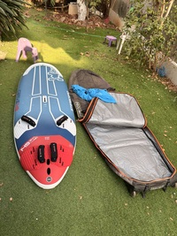
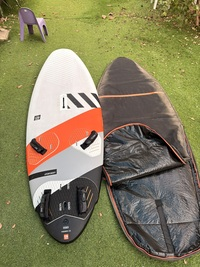
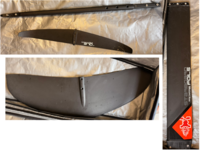
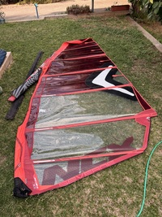
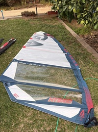
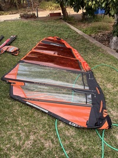
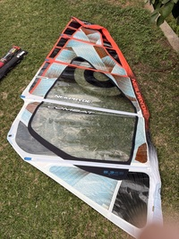
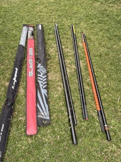
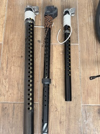
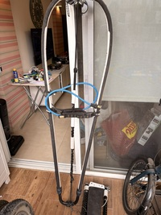

ציוד גלישת רוח למכירה

| Starboard carve 149 + bag    התיק מתאים לגלשן ושני מפרשים + שני תרנים + מנור + ציוד קטן  | 7500 |                                                            |
| ------------------------------------------------------------------------------------------------------- | ---- | -------------------------------------------------------------------------------------------------------------- |
| RRD Firemove 120 + Foil + bag  ימכר רק ביחד, גלשן, תיק ופוייל                               | 6500 |    |
| Severne NCX 8                                                                                           | 700  |                                                                |
| Gaastra Hybrid 7.2                                                                                      | 1700 |                                                          |
| RRD F-wing 6.0                                                                                          | 1500 |                                                          |
| Neil Pride Combat 5.3                                                                                   | 500  |                                                          |
| Point 7 460 SDM (95% carbon)                                                                            | 1200 |                                                            |
| Severne Gorilla RDM 430 (75% carbon)                                                                    | 900  |                                                                                                                |
| RRD 400 RDM (60% carbon)                                                                                | 600  |                                                                                                                |
| Point 7 SDM extension                                                                                   | 400  |                                                  |
| Point 7 RDM extension                                                                                   | 400  |                                                                                                                |
| RRD RDM extension                                                                                       | 200  |                                                                                                                |
| Mystic harness (L)                                                                                      | 500  |                                                                                                                |
| Liberty harness (L)                                                                                     | 800  |                                                                                                                |
| Boom (RRD, Aluminium)                                                                                   | 500  |                                                              |
